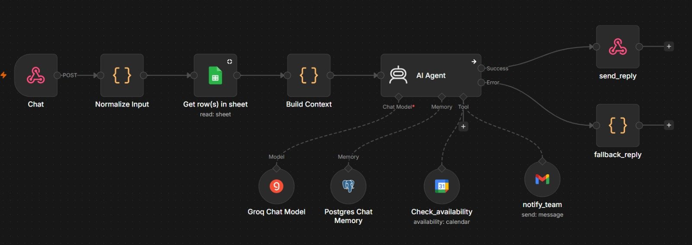

# Multilingual FAQ Chatbot (n8n)

n8n workflow that answers customer questions about scheduling and appointments. A website or a link sends a chat message to a webhook, the workflow looks up the answer in a Google Sheet FAQ, an LLM writes the reply in the language the customer used, and the reply goes back in the same request. If the FAQ does not have the answer, the bot says so and emails a human.

## What it does

- Takes a message and a `session_id` from a webhook call
- Reads FAQ from Google Sheet and passes it to model
- Remembers earlier messages of the same session, so follow-ups like "and on Monday?" work
- Answers only from the FAQ. If the answer is missing, it says it does not know and emails the support team
- Returns a fixed error message if the agent fails, so the website never gets an empty response



## How it works
- Chat Webhook
- Normalize Input        (clean message, sanitize session_id)
- Get row(s) in sheet    (read FAQ from Google Sheets)
- Build Context          (turn FAQ rows into one text block)
- AI Agent               (Groq model + Postgres chat memory + Gmail tool)
- send_reply             (Respond to Webhook, JSON)

- AI Agent error output = fallback_reply = send_reply


| Node | Type | Job |
|---|---|---|
| Chat Webhook | Webhook | POST `/faq-chat`, Header Auth |
| Normalize Input | Code (JavaScript) | Trims the message to 1000 characters, cleans `session_id`, adds a timestamp |
| Get row(s) in sheet | Google Sheets | Reads the `FAQ` tab |
| Build Context | Code (JavaScript) | Builds one `kb` text field from the rows |
| AI Agent | Tools Agent | Writes the reply from the FAQ and the chat history |
| Groq Chat Model | Chat model | The LLM used by the agent |
| Postgres Chat Memory | Memory | Stores chat history per `session_id` |
| notify_team | Gmail tool | Emails the support team when the FAQ has no answer |
| send_reply | Respond to Webhook | Returns `{ reply, session_id }` |
| fallback_reply | Code (JavaScript) | Fixed reply when the agent errors |

## in this repo

1. `faq-chatbot.json`: the n8n workflow (import directly)
2. `faq_sheet.xlsx`: sample with 10 rows
3. `README.md`: this file

---

## Prerequisites

- n8n, self-hosted or cloud. run it in Docker Desktop on Windows.
- A Google account (Sheets and Gmail)
- A Groq API key (https://console.groq.com)
- Postgres for chat memory. If you do not want to set one up, use the **Simple Memory** node instead. It needs no credentials, but history is lost when n8n restarts.

## Setup

### Step 1: Import the workflow

1. Open n8n and create new workflow.
2. Click the three dots menu, then **Import from file**.
3. Select `faq-chatbot.json`.

### Step 2: Create the Google Sheet

1. Upload `faq_sheet.xlsx` to Google Drive.
2. Open it and choose **File > Save as Google Sheets**. n8n cannot read a plain `.xlsx`.
3. Keep tab name `FAQ` and header row `topic`, `question`, `answer`.
4. Replace the sample answers with your own. The hours, prices, email and phone in the sample are placeholders.

### Step 3: Add credentials

| Node | Credential | Notes |
|---|---|---|
| Chat Webhook | Header Auth | Name `x-api-key`, Value: a long random string |
| Get row(s) in sheet | Google Sheets OAuth2 | Pick your FAQ document and the `FAQ` tab |
| Groq Chat Model | Groq API | Model: start with `llama-3.3-70b-versatile` |
| Postgres Chat Memory | Postgres | See below |
| notify_team | Gmail OAuth2 | Set the **To** field to your own address (hardcoded) |

**Postgres in Docker.** n8n runs in its own container, so `localhost` inside n8n is not your laptop. Use `host.docker.internal` as the host.

| Field | Value |
|---|---|
| Host | `host.docker.internal` |
| Port | `5432` |
| Database | your database |
| User / Password | your Postgres role |
| SSL | Disable |

The role needs permission to create the `n8n_chat_histories` table in `public` schema. See Troubleshooting if you get "permission denied".

To generate key for the webhook:

```
python -c "import secrets; print(secrets.token_hex(24))"
```

### Step 4: Check the expressions

Two places break silently when they are in Fixed mode instead of Expression mode:

- **AI Agent > Prompt (User Message)** must be in Expression mode:

  ```
  FAQ:
  {{ $json.kb }}

  User question: {{ $json.message }}
  ```

- **Postgres Chat Memory > Key** must be in Expression mode and must point to the node that outputs `session_id`:

  ```
  {{ $('Build Context').item.json.session_id }}
  ```

  If your Code node still has its default name (`Code in JavaScript`), use that name here, or rename the node.

**send_reply > Response Body** (Expression mode):

```
{{ JSON.stringify({ reply: $json.output, session_id: $('Normalize Input').item.json.session_id }) }}
```

## Test cases

Use a new `session_id` for each row, otherwise old history leaks into the next test.

| Message | What should happen |
|---|---|
| Are you open on Sunday? | Closed on Sundays, open Monday to Saturday |
| Kitna charge lagega? | Price from the sheet, reply in Hinglish |
| And on Monday? (same session as the first) | Follow-up answered using the earlier message |
| Do you accept dollar? (not in the FAQ) | Says it does not know, a human will follow up, support email sent |
| Wrong or missing `x-api-key` | 403 |

---

## Customization

**Change the bot's behaviour.** Edit **AI Agent > Options > System Message**:

**Change the FAQ.** Edit the Google Sheet. No workflow change is needed.

**Change the model.** 

## Limitations

- It answers from static FAQ text. It does not check live availability, book, or cancel. A Google Calendar or Cal.com node can be added as tool for that.
- Language support follows model. The workflow itself does not limit languages, but quality drops in low-resource languages, so test each language you plan to advertise.
- The Postgres memory is fine for a demo. It has no cleanup, so old sessions stay in the table.
- Sheets as a data source adds some latency and has API quotas.

## Roadmap

- [ ] Live slot availability through a Calendar tool
- [ ] Simple chat widget (frontend) that talks to a backend route, not to n8n directly
- [ ] Vector search for larger FAQs
- [ ] Rate limiting in front of the webhook

## Resources

- n8n docs: https://docs.n8n.io
- n8n community: https://community.n8n.io
- Groq docs: https://console.groq.com/docs
